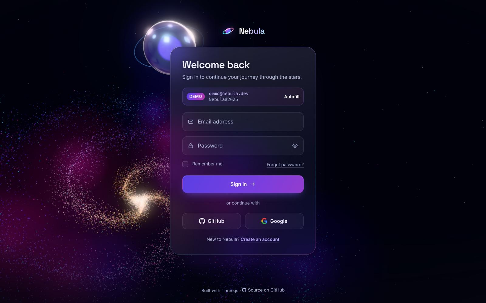

<div align="center">

# Nebula Auth

**An interactive 3D login and sign-up experience: frosted-glass forms floating in front of a real-time WebGL galaxy that reacts to everything you type.**

[](https://github.com/arslanagayev/nebula-auth/actions/workflows/ci.yml)
[](https://github.com/arslanagayev/nebula-auth/actions/workflows/deploy.yml)
[](LICENSE)
[](tsconfig.app.json)
[](https://threejs.org)



### [Live demo](https://arslanagayev.github.io/nebula-auth/)

</div>

---

## Features

- **GPU-animated spiral galaxy**: up to 30,000 stars rendered with a custom GLSL `ShaderMaterial`. The orbit, twinkle, swirl and shockwaves all run in the vertex shader, so the CPU never touches the vertex buffer after upload. The arms turn like a density wave, so the spiral never winds itself into a blur.
- **Iridescent glass core**: a smooth `MeshPhysicalMaterial` orb (transmission, iridescence, dispersion, clearcoat, PMREM environment) that refracts the galaxy and floats behind the card's corner, so its colour bleeds through the frosted glass.
- **A composition that follows the layout**: the galaxy's glowing centre sits beside the card on wide screens and below it on phones, and the core stays pinned to the card's corner.
- **Glassmorphism card**: translucent fill, `backdrop-filter` blur and saturation, a gradient hairline border drawn with CSS masks, an inner highlight and layered shadows.
- **Tactile 3D interactions**: pointer-driven card tilt with a moving glare, a real 3D flip between _Sign in_ and _Create account_, and mouse parallax on the camera.
- **A scene that reacts to the UI**, through a typed event bus:

  | Interaction              | 3D reaction                                                  |
  | ------------------------ | ------------------------------------------------------------ |
  | Focus a field            | The galaxy spins slightly faster                             |
  | Type a new password      | The core pulses red → amber → green → cyan with its strength |
  | Submit (request pending) | A strong vortex swirls the galaxy and the core spins up      |
  | Success                  | A shockwave and a cyan-green colour burst                    |
  | Error                    | A brief red flash and a card shake                           |
  | Flip the card            | The galaxy gets a rotational kick                            |

- **Production-grade forms**: floating labels, live validation with `aria-invalid` and `aria-describedby`, show/hide password, Caps Lock warning, a 4-segment strength meter, loading states, a lockout countdown and success screens.
- **Realistic mock API**: simulated latency, a seeded demo account, registration, typed `Result` errors and a 30-second lockout after 5 failed attempts.
- **Robust by default**: a CSS nebula fallback without WebGL or after a shader error, a static frame for reduced motion, rendering paused in background tabs, WebGL context-loss recovery and adaptive quality.

## Demo credentials

| Email             | Password      |
| ----------------- | ------------- |
| `demo@nebula.dev` | `Nebula#2026` |

Or click the **Demo** pill on the card to have them typed in for you. Accounts you create live in memory until you reload the tab. No data leaves your browser.

## Tech stack

| Area     | Choice                                                                            |
| -------- | --------------------------------------------------------------------------------- |
| Language | TypeScript 6 (`strict`, `noUncheckedIndexedAccess`, `exactOptionalPropertyTypes`) |
| 3D       | three.js r186, custom GLSL shaders, `UnrealBloomPass` + `OutputPass`              |
| UI       | Vanilla DOM and modern CSS (custom properties, masks, `backdrop-filter`, `inert`) |
| Build    | Vite 8 with a lazily loaded scene chunk                                           |
| Quality  | ESLint 10 + typescript-eslint (strict, type-checked), Prettier                    |
| Testing  | Vitest 5, happy-dom, V8 coverage                                                  |
| Fonts    | Inter and Space Grotesk variable fonts, self-hosted via Fontsource                |
| CI/CD    | GitHub Actions: CI on Node 22 and 24, test-gated GitHub Pages deploys, Dependabot |

No UI framework on purpose: the project shows what the platform can do with well-structured TypeScript and CSS.

## Getting started

Requires **Node.js 22.13+** (22 LTS or 24 LTS; the repository pins 24 in `.nvmrc`, and CI tests both).

```bash
git clone https://github.com/arslanagayev/nebula-auth.git
cd nebula-auth
npm ci
npm run dev
```

Open the printed URL (usually <http://localhost:5173>). Add `?quality=high` (or `medium` / `low`) to pin a rendering tier, e.g. for screen recordings.

To deploy your own copy: push to GitHub, set **Settings → Pages → Source** to **GitHub Actions**, then re-run the Deploy workflow (**Actions → Deploy → Run workflow**). The first run fails until Pages is enabled, which leaves the Deploy badge red until it is re-run. The workflow lints and tests before it builds, and reads the correct base path from the Pages configuration, so a renamed fork or a custom domain works without changes.

## Scripts

| Script                  | Description                                             |
| ----------------------- | ------------------------------------------------------- |
| `npm run dev`           | Start the Vite dev server with hot module replacement   |
| `npm run build`         | Type-check and create a production build in `dist/`     |
| `npm run preview`       | Serve the production build locally                      |
| `npm run lint`          | Lint with ESLint and type-aware typescript-eslint rules |
| `npm run format`        | Format the codebase with Prettier                       |
| `npm run format:check`  | Verify formatting (used in CI)                          |
| `npm run typecheck`     | Run the TypeScript compiler in build mode               |
| `npm test`              | Run the test suite once                                 |
| `npm run test:watch`    | Run tests in watch mode                                 |
| `npm run test:coverage` | Run tests with V8 coverage and enforce thresholds       |

## Project structure

```text
nebula-auth/
├── index.html                  # Semantic markup for both card faces
├── public/favicon.svg
├── src/
│   ├── main.ts                 # Bootstrap: UI first, then lazy-load the 3D scene
│   ├── core/                   # No DOM, no WebGL
│   │   ├── events.ts           # Typed publish/subscribe EventBus (state + transient events)
│   │   ├── appEvents.ts        # The UI ↔ scene event contract
│   │   └── types.ts            # Shared domain types
│   ├── lib/                    # Pure, fully tested logic
│   │   ├── validation.ts       # Email, name, password and confirmation rules
│   │   ├── passwordStrength.ts # 0–4 strength score with actionable hints
│   │   ├── authService.ts      # Mock API: latency, demo account, lockout
│   │   ├── sceneMotion.ts      # Scene choreography: events → eased animation targets
│   │   ├── quality.ts          # Device-based rendering budget and quality ladder
│   │   ├── frameBudget.ts      # Adaptive quality monitor
│   │   └── math.ts, random.ts, result.ts, commonPasswords.ts
│   ├── scene/                  # three.js, loaded as a separate chunk
│   │   ├── loadScene.ts        # Feature detection, quality, warm-up, fallback
│   │   ├── NebulaScene.ts      # Renderer, camera, loop, layout, context loss, disposal
│   │   ├── galaxy.ts           # Galaxy points, ShaderMaterial and dust clouds
│   │   ├── galaxyData.ts       # Seeded star distribution
│   │   ├── core.ts             # Iridescent glass core
│   │   ├── postprocessing.ts   # Bloom + output passes
│   │   ├── starfield.ts, textures.ts, palette.ts, support.ts
│   │   └── shaders/            # galaxy.vert.glsl, galaxy.frag.glsl
│   ├── ui/
│   │   ├── authForms.ts        # Composes the flows below
│   │   ├── signInFlow.ts       # Sign-in, lockout countdown, success screen
│   │   ├── registerFlow.ts     # Registration and the strength meter
│   │   ├── form.ts             # Generic form controller + password helpers
│   │   ├── flip.ts             # 3D card flip with focus management
│   │   ├── tilt.ts             # Pointer tilt and glare
│   │   ├── toast.ts            # Notifications with a separate live region
│   │   ├── cardFeedback.ts     # Card shake and rim, driven by the bus
│   │   ├── layout.ts           # Publishes the card position to the scene
│   │   └── demoAutofill.ts, documentState.ts, panels.ts, strengthMeter.ts, dom.ts
│   └── styles/                 # Tokens, base, layout, card, forms, buttons, toasts, animations, reduced motion
├── tests/                      # Unit, loader and DOM tests (helpers/ mounts index.html)
├── docs/ARCHITECTURE.md
└── .github/                    # CI + Pages workflows, Dependabot
```

## Architecture

The UI and the WebGL scene never import each other. The UI publishes intent on a strongly typed event bus (`field:focus`, `password:strength`, `auth:pending`, `auth:success`, `auth:error`, `view:flip`, …) and the scene turns those events into animation targets that are eased every frame. A pure `SceneDirector` decides how the scene reacts, so even the 3D behaviour is unit-tested. This keeps the 150 kB (gzipped) three.js chunk off the critical path, lets every UI module be tested without a GPU, and means the page works exactly the same when WebGL is unavailable.

Read [docs/ARCHITECTURE.md](docs/ARCHITECTURE.md) for module and event-flow diagrams, the render loop, the shader maths and the performance and accessibility decisions.

## Accessibility and performance

**Accessibility**

- Semantic `<form>`, `<label>` and heading structure; every control works with the keyboard.
- Validation errors are linked with `aria-describedby`, flagged with `aria-invalid` and only appear after a field is left, never mid-typing. Password requirements are stated before the first keystroke. Authentication errors use `role="alert"`, toast messages go to a separate polite live region.
- The hidden card face is `inert`, so it is removed from the tab order and the accessibility tree. Focus moves into the new face after each flip (to its heading on touch screens, so the keyboard does not pop up mid-animation).
- Visible focus indicators everywhere (also in forced-colors mode), 44 px touch targets on touch screens, and text colours chosen to meet WCAG 2.2 AA contrast on the glass surface.
- `prefers-reduced-motion`: no tilt, shake, shimmer or drift, instant flips and a static 3D frame.

**Performance**

- The form is interactive before three.js is even requested: the scene is a separate chunk loaded after the first paint, and its shaders compile asynchronously (`KHR_parallel_shader_compile`) so typing never stutters.
- All star motion happens in the vertex shader, and the render loop reuses preallocated frame objects.
- Device pixel ratio is capped (2 on desktop, 1.5 on mobile, 1 on low-end devices) and follows zoom and monitor changes; particle counts scale by device tier and bloom only runs on capable desktops.
- The glass core's refraction pass renders at half resolution or less (and not at all on low-end devices) instead of copying the full-resolution frame every frame.
- A frame-time monitor drops bloom, then refraction resolution, then pixel ratio if the device cannot keep up, and undoes steps that did not help (a display capped at 30 Hz is not a slow GPU).
- Rendering stops while the tab is hidden, resizes are debounced, and teardown disposes every resource and releases the WebGL context.

## Testing

```bash
npm test               # 230+ unit, loader and DOM tests
npm run test:coverage  # enforces ≥ 90% line coverage for src/lib, src/core, src/ui and src/scene
```

- **Pure logic** (`src/lib`, `src/core`) is covered at 100% of lines: validators, the strength estimator, the auth service with fake timers (latency, lockout, unlock), the event bus, the scene director and orbit maths (including a check that the spiral never winds up), quality profiles, the frame-time monitor and maths helpers.
- **Markup checks** parse the shipped `index.html` and fail on dangling ARIA references, duplicate ids, unlabelled controls, untyped buttons or SVGs exposed to screen readers.
- **DOM behaviour** is tested with happy-dom against the real `index.html` markup: live validation, ARIA attributes, loading and success states, the lockout countdown, password toggles, the Caps Lock hint, the strength meter, flips with focus management, tilt and toasts.
- **The scene loader** runs against a stand-in scene: the CSS fallback without WebGL, compiling before the first frame, `?quality=` pinning and releasing a half-started scene when set-up fails. The scene's colours are checked against the CSS design tokens.
- Only the rendering code itself (renderer, meshes, passes) is excluded from coverage, because it needs a real GPU.

## Roadmap

- [ ] Playwright end-to-end tests with visual regression snapshots of the reduced-motion frame
- [ ] A real `AuthService` adapter (OIDC / REST) with `httpOnly` cookie sessions
- [ ] Passkey (WebAuthn) sign-in as the primary option
- [ ] Breached-password check using the Have I Been Pwned k-anonymity API
- [ ] A WebGPU renderer path with TSL shaders, falling back to WebGL 2
- [ ] Localised validation messages and right-to-left layout support

## Author

**Arslan Agayev**, computer science student building interactive web experiences.

- GitHub: [@arslanagayev](https://github.com/arslanagayev)
- Instagram: [@arslanagayev.dev](https://www.instagram.com/arslanagayev.dev/)

## License

[MIT](LICENSE) © 2026 Arslan Agayev
