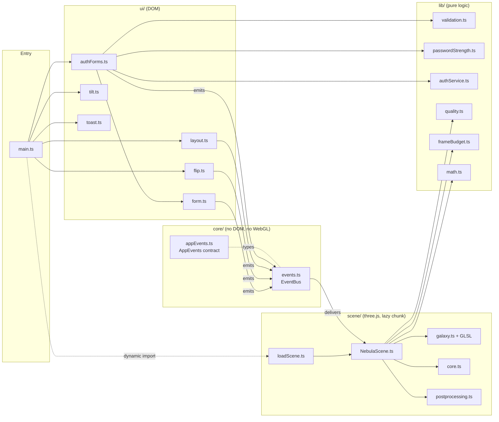

# Architecture

Nebula Auth is a single-page, framework-free TypeScript app. It is built around one rule:

> **The UI and the 3D scene never import each other.** They communicate only through a typed
> event bus.

That rule drives most of the other decisions: three.js can be loaded lazily, the forms work
identically with or without WebGL, and every UI module can be tested in a DOM emulator without
a GPU.

## Module map



| Layer    | Responsibility                                                              | Depends on         |
| -------- | --------------------------------------------------------------------------- | ------------------ |
| `core/`  | The event bus and the event contract                                        | nothing            |
| `lib/`   | Pure functions and services: validation, strength, mock API, quality, maths | `core/` types only |
| `ui/`    | DOM controllers for forms, flip, tilt, toasts and layout                    | `core/`, `lib/`    |
| `scene/` | Renderer, camera, render loop, galaxy, glass core, post-processing          | `core/`, `lib/`    |
| `main`   | Wires everything together and decides when (and whether) to load the scene  | all of the above   |

## The event contract

`src/core/appEvents.ts` is the single source of truth for everything the two halves say to
each other. Payloads are fully typed, so a renamed field is a compile error on both sides.

| Event               | Emitted by       | Scene reaction                                         |
| ------------------- | ---------------- | ------------------------------------------------------ |
| `field:focus/blur`  | `FormController` | Galaxy rotation speed ×1.9 while a field is focused    |
| `password:strength` | register form    | Core colour and pulse rate (weak = fast, red)          |
| `auth:pending`      | both forms       | Vortex swirl, galaxy speed ×5.2, core spins up         |
| `auth:success`      | both forms       | Shockwave + cyan/green burst, core turns cyan-green    |
| `auth:error`        | both forms       | Red flash on galaxy and core                           |
| `auth:reset`        | success screens  | Core returns to the current strength colour            |
| `view:flip`         | `flip.ts`        | Rotational kick                                        |
| `layout:card`       | `layout.ts`      | Re-anchors the core to the card's top-left corner      |
| `scene:status`      | `NebulaScene`    | (UI side) fades the canvas in or restores CSS fallback |

The bus supports **replay**: the scene subscribes to `layout:card` and `password:strength` with
`{ replay: true }`, so a scene that finishes loading late still receives the current state.
Subscriptions take an `AbortSignal`, which makes teardown a single `controller.abort()`.

### Example: submitting the sign-in form


## Loading strategy

1. `index.html` contains the complete markup, so the card paints with the first HTML/CSS
   response. An animated CSS nebula (layered radial gradients) is visible immediately.
2. `main.ts` (≈10 kB gzipped) initialises the forms, flip, tilt and toasts. The page is fully
   usable at this point.
3. After the first frame, `loadScene()` checks for WebGL 2 (rejecting software rasterisers via
   `failIfMajorPerformanceCaveat`) and only then dynamically imports the scene chunk
   (three.js, ≈150 kB gzipped).
4. When the first WebGL frame has rendered, the scene emits `scene:status: ready`; the canvas
   fades in over the CSS nebula, which is then hidden and its animation paused.

If anything fails (no WebGL, a shader error, a lost context) the CSS background simply stays.

## The render loop

`renderer.setAnimationLoop` drives one `tick` per display frame:

```text
tick(time)
 ├─ dt = min(time - last, 50 ms)      clamp so a hitch never teleports the galaxy
 ├─ FrameBudget.sample(dt)            sustained > 22 ms average → degrade quality
 ├─ update(dt)
 │   ├─ damp() every animated value towards its target
 │   ├─ phase += dt · baseSpeed · (speed + kick)
 │   ├─ galaxy.update(phase, swirl, burst, flash)   → shader uniforms only
 │   ├─ core.update(...)                             → colour, pulse, spin, position
 │   └─ camera parallax + lookAt
 └─ render(): EffectComposer (bloom) or plain renderer.render()
```

**Frame-rate independent easing.** Every animated value uses
`damp(current, target, λ, dt) = lerp(current, target, 1 − e^(−λ·dt))`. Unlike a fixed
`lerp(a, b, 0.1)` per frame, this converges identically at 60, 120 or 144 Hz.

**Integrated phase.** The galaxy's rotation is not `time × speed`; it is a phase that
accumulates `speed · dt`. Changing speed therefore never makes the galaxy jump, it only
accelerates or decelerates smoothly.

**Background tabs cost nothing.** Rendering stops on `visibilitychange` (hidden tab) and restarts with a
fresh clock. With reduced motion there is no loop at all: each relevant event requests one
static frame.

## The galaxy shader

Star positions are generated once on the CPU with a seeded PRNG (`mulberry32`), so the galaxy
looks identical on every load and in every screenshot. Each star stores its base position on
the disc, a scatter offset, a colour and a size. Everything else happens in
`galaxy.vert.glsl`:

- **Differential rotation**: `angle += phase / (0.35 + 0.55·r)`. Angular velocity falls off
  with radius, so the inner galaxy turns faster and the arms slowly wind up.
- **Pending vortex**: `angle += swirl · 2.2 · c²` and `r *= 1 − swirl · 0.18 · c`, where
  `c = 1 − r / R` is 1 at the core. The twist is concentrated in the centre.
- **Success shockwave**: `r *= 1 + burst · 0.16 · (0.35 + c)`, plus larger, brighter points.
- **Size attenuation**: `gl_PointSize = size · scale · dpr / −z_view`.

The fragment shader draws a soft, round sprite without a texture lookup
(`pow(1 − 2d, 2.4)`, discarding outside the circle) and mixes in the flash and burst colours.
Points use additive blending, so thousands of overlapping stars accumulate into the glowing
core. Stars near the centre are generated dimmer to keep that accumulation from clipping.

The material is intentionally in the **opaque** render list (additive blending still applies):
three.js only feeds opaque objects into the transmission pass, and this is what lets the glass
core refract the galaxy behind it.

## The glass core

`core.ts` combines a flat-shaded icosahedron with `MeshPhysicalMaterial` (transmission 1,
iridescence, dispersion, clearcoat, PMREM `RoomEnvironment` reflections), an emissive heart
whose HDR colour feeds the bloom pass, an orbit ring and a sprite halo for devices without
bloom.

It is anchored to the DOM: `layout.ts` publishes the card's rectangle, and the scene unprojects
the card's top-left corner onto the core's depth plane using a parallax-free reference camera.
Its size is defined in CSS pixels (48–104 px radius) and converted to world units, so it looks
the same on every screen. Because it sits behind the card's corner, the card's
`backdrop-filter` blurs it and its colour bleeds through the glass.

## Performance decisions

| Decision                                                 | Why                                                    |
| -------------------------------------------------------- | ------------------------------------------------------ |
| Scene in a separate chunk, loaded after first paint      | Keeps the critical path at ≈10 kB of JS                |
| All star animation in the vertex shader                  | No buffer re-uploads, no per-frame CPU work per star   |
| DPR capped at 2 / 1.5 / 1 (desktop / mobile / low-end)   | Fill rate is the bottleneck for additive point sprites |
| 30k / 16k / 8k particles by device tier                  | Chosen from cores, memory, pointer type and data saver |
| Bloom only on high-tier desktops without reduced motion  | The halo sprite provides a cheap glow elsewhere        |
| `FrameBudget` degrades bloom, then resolution at runtime | Adapts to thermal throttling and busy machines         |
| No allocations in `tick`                                 | Avoids garbage-collection pauses                       |
| Debounced resize, paused hidden tabs, full `dispose()`   | Battery life and no leaked GPU memory during HMR       |
| Tilt writes CSS variables once per frame, stops at rest  | No layout thrashing, no idle rAF loop                  |

## Accessibility decisions

- **Validation timing**: errors appear after a field is left or on submit, never while someone
  is typing their first attempt, and disappear on the keystroke that fixes them.
- **Announcements**: field errors are linked via `aria-describedby` (read on focus); auth
  failures use an inline `role="alert"`; toasts use a polite live region whose close glyph is
  `aria-hidden`. The lockout countdown only updates the button label, so screen readers are not
  interrupted every second.
- **Busy states** use `aria-busy` and `aria-disabled` rather than `disabled`, so focus is not
  lost while a request is pending.
- **Card flip**: the hidden face is `inert`. Focus moves to the first field of the new face once
  it becomes visible. With reduced motion the swap is instant.
- **Glass and contrast**: text colours are chosen against the composited glass, a 66 % dark
  fill over the blurred galaxy. Body and secondary text stay above 4.5:1 over the violet and
  cyan arms, and stars near the galaxy's centre (which sits behind the card) are generated
  dimmer so the core cannot wash the card out. The primary gradient stops keep white button
  text above 4.5:1.
- **Motion**: `prefers-reduced-motion` disables tilt, parallax, shake, shimmer and drift, and the
  scene renders static frames. Changes to the preference are picked up live.

## Testing strategy

| Level        | Tooling              | Scope                                                            |
| ------------ | -------------------- | ---------------------------------------------------------------- |
| Unit         | Vitest (Node)        | `lib/` and `core/`: 100 % line coverage, enforced ≥ 90 % in CI   |
| DOM          | Vitest + happy-dom   | Real `index.html` markup: forms, ARIA, flip, tilt, toasts        |
| Time-based   | `vi.useFakeTimers()` | Latency, lockout, countdowns, toast timers, flip timing          |
| Visual / GPU | Not automated yet    | The WebGL scene needs a real GPU; its pure parts are unit-tested |

## Known trade-offs

- The auth service is a mock that keeps accounts in memory; the `AuthService` interface is the
  seam for a real backend.
- `backdrop-filter` cost scales with the blurred area; the card is the only large blurred
  surface.
- The WebGL layer has no automated tests because it needs a real GPU. Covering it with
  Playwright and screenshot diffs of the reduced-motion frame is the next item on the roadmap.
