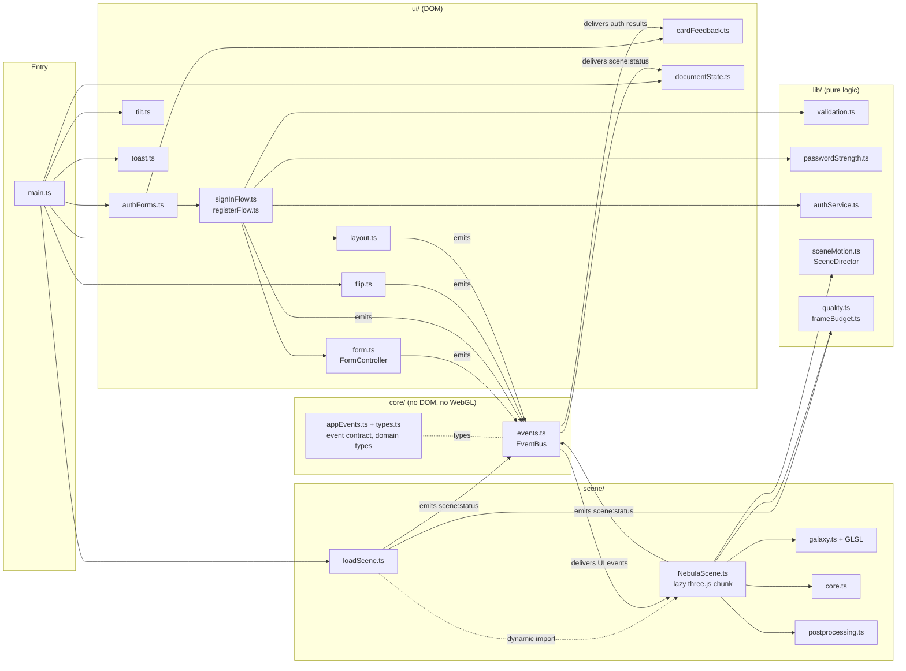
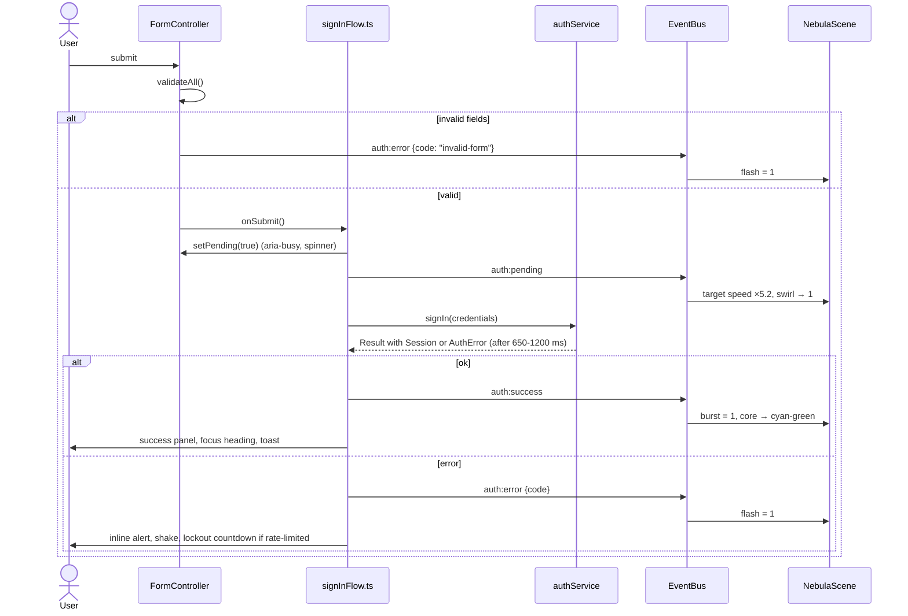

# Architecture

Nebula Auth is a single-page, framework-free TypeScript app. It is built around one rule:

> **The UI and the 3D scene never import each other.** They communicate only through a typed
> event bus.

That rule drives most of the other decisions: three.js can be loaded lazily, the forms work
identically with or without WebGL, and every UI module can be tested in a DOM emulator without
a GPU.

## Module map



| Layer    | Responsibility                                                                    | Depends on         |
| -------- | --------------------------------------------------------------------------------- | ------------------ |
| `core/`  | The event bus, the event contract and the shared domain types                     | nothing            |
| `lib/`   | Pure logic: validation, strength, mock API, scene choreography, quality, maths    | `core/` types only |
| `ui/`    | DOM controllers: form flows, flip, tilt, toasts, card feedback, layout, doc state | `core/`, `lib/`    |
| `scene/` | Renderer, camera, render loop, galaxy, glass core, post-processing                | `core/`, `lib/`    |
| `main`   | Wires everything together and decides when (and whether) to load the scene        | all of the above   |

Domain types that both sides need (`AuthView`, `AuthErrorCode`, `StrengthScore`, the text field
names) live in `core/types.ts`, so `lib/` imports them from `core/` and never the other way
round.

## The event contract

`src/core/appEvents.ts` is the single source of truth for everything the two halves say to
each other. Payloads are fully typed, so a renamed field is a compile error on both sides.

| Event               | Emitted by                             | Reaction                                                     |
| ------------------- | -------------------------------------- | ------------------------------------------------------------ |
| `field:focus/blur`  | `FormController`                       | Galaxy rotation speed ×1.9 while a field is focused          |
| `password:strength` | register flow                          | Core colour and pulse rate (weak = fast, red)                |
| `auth:pending`      | sign-in and register flows             | Vortex swirl, galaxy speed ×5.2, core spins up               |
| `auth:success`      | sign-in and register flows             | Shockwave, cyan/green burst, green card rim, tab title       |
| `auth:error`        | flows, `FormController` (invalid form) | Red flash on galaxy and core, card shake and red rim         |
| `auth:reset`        | success screens                        | Core returns to the current strength colour                  |
| `view:flip`         | `flip.ts`                              | Rotational kick, tab title                                   |
| `layout:card`       | `layout.ts`                            | Re-anchors the core to the card and re-frames the galaxy     |
| `scene:status`      | `NebulaScene`, `loadScene`             | (UI side) fades the canvas in, or brings the CSS nebula back |

Events come in two kinds. **State events** (`layout:card`, `password:strength`,
`scene:status`) describe a current value: the bus remembers their latest payload, and a
subscriber that arrives late (the lazily loaded scene) can ask for it with `{ replay: true }`.
**Transient events** (`auth:error`, `view:flip`, …) are delivered once and forgotten; `replay`
does not type-check for them, so a stale error can never be replayed. Subscriptions take an
`AbortSignal`, which makes teardown a single `controller.abort()`.

The scene and the card react to the _same_ events: `cardFeedback.ts` shakes the card on every
`auth:error`, so an invalid submit, a wrong password and a lockout look alike, with or without
WebGL.

### Example: submitting the sign-in form



If `onSubmit` throws (a real backend's network or parsing error), `FormController` ends the
pending state, shows a generic message and emits `auth:error` with the code `unexpected`, so
neither the form nor the galaxy can get stuck in "pending".

## Loading strategy

1. `index.html` contains the complete markup, so the card paints with the first HTML/CSS
   response. An animated CSS nebula (layered radial gradients) is visible immediately, and the
   two latin font files are preloaded.
2. `main.ts` (≈12 kB of JS gzipped, including `loadScene.ts` and the quality heuristics)
   initialises the forms, flip, tilt and toasts. The page is fully usable at this point.
3. After the first frame, `loadScene()` checks for WebGL 2 (rejecting software rasterisers via
   `failIfMajorPerformanceCaveat`) and only then dynamically imports `NebulaScene` (three.js,
   ≈150 kB gzipped).
4. Set-up is split into tasks so input is never blocked for long: the chunk is parsed; the
   stars and the PMREM environment are generated; every shader program is compiled with
   `renderer.compileAsync()`, which uses `KHR_parallel_shader_compile` where available. With
   bloom, the programs are compiled against the composer's render target, which is the
   variant the first frames use.
5. When the first WebGL frame has rendered, the scene emits `scene:status: ready`; the canvas
   fades in over the CSS nebula, which is then hidden and its animation paused.

`?quality=high|medium|low` pins a quality tier and turns adaptive quality off, e.g. so that a
screen recording never loses its bloom to the recorder's own load.

### When things go wrong

| Situation                                      | What happens                                                                |
| ---------------------------------------------- | --------------------------------------------------------------------------- |
| No WebGL 2, or a software rasteriser           | The three.js chunk is never downloaded; the CSS nebula stays                |
| The renderer or the warm-up throws             | The half-built scene is disposed (context released), `unavailable` is sent  |
| A shader fails to compile or link              | `renderer.debug.onShaderError` stops the loop and reports `unavailable`     |
| The WebGL context is lost                      | `lost` is sent, the CSS nebula returns at once and nothing is rendered      |
| The context is restored                        | The PMREM environment is rebuilt, the loop restarts and the canvas fades in |
| `prefers-reduced-motion` changes while running | The loop stops (or starts); static frames are rendered on demand            |

## The render loop

`renderer.setAnimationLoop` drives one `tick` per display frame:

```text
tick(time)
 ├─ frameMs = time − last; dt = min(frameMs, 50 ms)   clamp so a hitch never teleports the galaxy
 ├─ FrameBudget.sample(frameMs)       two slow windows → degrade; step did not help → restore
 ├─ update(dt)
 │   ├─ SceneDirector.step(dt, pointer)   damp every animated value, integrate the orbit phase
 │   ├─ galaxy.update(frame)               → shader uniforms only
 │   ├─ core.update(frame)                 → colour, pulse, spin, position
 │   └─ camera: eased distance + pointer parallax, lookAt
 └─ render(): EffectComposer (bloom) or plain renderer.render()
```

**The director is pure.** `lib/sceneMotion.ts` holds the choreography: which UI event cues
which reaction (`focus`, `pending`, `success`, …), the target of every animated value and how
it decays. `NebulaScene` only copies the numbers into uniforms and transforms, into frame
objects that are allocated once. All of the scene's behaviour is therefore unit-tested
without WebGL.

**Frame-rate independent easing.** Every animated value uses
`damp(current, target, λ, dt) = lerp(current, target, 1 − e^(−λ·dt))`. Unlike a fixed
`lerp(a, b, 0.1)` per frame, this converges identically at 60, 120 or 144 Hz.

**Integrated phase.** The galaxy's rotation is not `time × speed`; it is a phase that
accumulates `speed · dt`. Changing speed therefore never makes the galaxy jump, it only
accelerates or decelerates smoothly.

**Background tabs cost nothing.** Rendering stops on `visibilitychange` (hidden tab) and restarts
with a fresh clock. With reduced motion there is no loop at all: each relevant event requests
one static frame in a fixed, resting pose.

## The galaxy shader

Star positions are generated once on the CPU with a seeded PRNG (`mulberry32`), so the galaxy
looks identical on every load and in every screenshot. Each star stores its base position on
an arm, a scatter offset, a colour and a size. Everything else happens in `galaxy.vert.glsl`,
with `c = 1 − r / R` (1 at the centre, 0 at the rim):

- **Orbit**: `angle += phase · 0.55 + 0.35 · c² · sin(0.3 · phase)`. The arm pattern turns
  rigidly, like the density wave that real spiral arms are, and the inner disc only sways by a
  bounded amount. Purely differential rotation (angular speed falling with radius) looks more
  "physical" for a minute, then winds the arms up without limit and smears the spiral into a
  plain disc: the winding problem. The parameters come in as one `uOrbit` uniform from the
  same constants that `orbitAngle()` uses in TypeScript, where a test checks that the twist
  stays bounded over an hour of pending swirl.
- **Pending vortex**: `angle += swirl · 2.2 · c²` and `r *= 1 − swirl · 0.18 · c`. The twist
  is concentrated in the centre.
- **Success shockwave**: `r *= 1 + burst · 0.16 · (0.35 + c)`, plus larger, brighter points.
- **Point size**: `gl_PointSize = size · scale · (bufferHeight / 1000) · twinkle / −z_view`.
  Scaling by the drawing-buffer height (which already includes the pixel ratio) keeps stars
  the same size relative to the frame on a phone and on a 4K monitor.

The fragment shader draws a soft, round sprite without a texture lookup
(`pow(max(0, 1 − 2d), 2.4)`) and mixes in the flash and burst colours. There is no `discard`:
with additive blending a zero alpha adds nothing, and tile-based mobile GPUs stay fast.

**Colour and bloom.** Stars run from a warm white centre through violet arms to cyan at the
rim, with pink and cyan accents. Points use additive blending, so thousands of overlapping
stars accumulate into the glowing centre; stars near the centre are generated dimmer to keep
that from clipping, except the innermost few, which are lifted above 1.0. With a bloom
threshold of 0.6, that centre and the glass core's heart are the only things that glow, and
the background stays black instead of turning into a navy haze. A dozen faint violet and pink
sprites along the arms add soft "gas" and turn with the arm pattern.

The material is intentionally in the **opaque** render list (additive blending still applies):
three.js only feeds opaque objects into the transmission pass, and this is what lets the glass
core refract the galaxy behind it.

## Composition

The scene is anchored to the DOM. `layout.ts` publishes the card's rectangle (from the
untransformed `.auth` box, so tilting never moves anything), and the scene unprojects screen
points onto depth planes with a parallax-free reference camera:

- **Galaxy**: its bright centre sits beside the card on wide screens (lower left, so the arms
  still sweep behind the glass) and below it on tall ones, never directly behind the text.
  Portrait screens pull the camera back a little; the distance is eased, so layout changes
  never make the galaxy jump.
- **Glass core**: it floats over the card's top-left corner, so the card's `backdrop-filter`
  blurs part of it and its colour bleeds through the glass. Below 480 px it moves to the
  top-right corner, away from the heading, and it is always kept fully inside the viewport. Its
  size is defined in CSS pixels (48–104 px radius) and converted to world units.

## The glass core

`core.ts` combines a smooth icosphere with `MeshPhysicalMaterial` (transmission, iridescence,
a little dispersion, clearcoat and PMREM `RoomEnvironment` reflections), an emissive heart
whose HDR colour feeds the bloom pass, a comet-like orbit ring whose brightness fades behind
its head, and a sprite halo that takes over the glow where there is no bloom. The strength
colour also tints the glass body (emissive), so it reads without bloom and no part of the
shell ever renders black. On low-end devices the shell is a thin reflective bubble without
transmission, which costs no extra render pass.

## Performance decisions

| Decision                                                               | Why                                                                                                                                                                                       |
| ---------------------------------------------------------------------- | ----------------------------------------------------------------------------------------------------------------------------------------------------------------------------------------- |
| Scene in a separate chunk, loaded after first paint                    | Keeps the critical path at ≈12 kB of JS                                                                                                                                                   |
| Set-up split into tasks, shaders compiled with `compileAsync`          | No long main-thread task while someone types                                                                                                                                              |
| All star animation in the vertex shader                                | No buffer re-uploads, no per-frame CPU work per star                                                                                                                                      |
| DPR capped at 2 / 1.5 / 1 (desktop / mobile / low-end)                 | Fill rate is the bottleneck for additive point sprites; zoom and monitor changes are followed within the cap                                                                              |
| 30k / 16k / 8k particles by device tier                                | Chosen from cores, memory, pointer type and data saver                                                                                                                                    |
| Transmission pass at 0.5 / 0.35 resolution, off on low-end devices     | three.js re-renders the scene behind the glass every frame; at full resolution (4× MSAA, half float, mipmaps) that is roughly 350 MB of VRAM at 3024×1964, for an orb at most 200 px wide |
| Bloom only on high-tier desktops without reduced motion                | The halo sprite provides a cheap glow elsewhere                                                                                                                                           |
| MSAA on the composer's target, not the canvas, when bloom is on        | The scene is drawn into the composer's target; the canvas only receives a full-screen triangle                                                                                            |
| `FrameBudget`: bloom → transmission → resolution, undoes useless steps | Adapts to thermal throttling, but a display capped at 30 Hz is not mistaken for a slow GPU                                                                                                |
| High-performance GPU requested on the top tier only                    | A sign-in page should not wake a laptop's discrete GPU                                                                                                                                    |
| Preallocated frame objects and scratch vectors                         | No garbage in the render loop or on scroll-driven layout updates                                                                                                                          |
| Canvas sized in `lvh` and observed with `ResizeObserver`               | Collapsing mobile toolbars never reallocate GPU buffers                                                                                                                                   |
| Paused hidden tabs, `dispose()` plus a forced context loss             | `renderer.dispose()` leaves the transmission target behind; losing the context frees it, and HMR swaps in a fresh canvas                                                                  |
| Tilt writes one transform per frame and stops at rest                  | Glare variables live on the glare layers only, so the form subtree is not restyled every frame                                                                                            |

## Accessibility decisions

- **Validation timing**: errors appear after a field with input is left or on submit, never
  while someone is typing their first attempt, and disappear on the keystroke that fixes them.
  Tabbing past an untouched field (including the Terms checkbox) never shows an error.
- **Announcements**: field errors are linked via `aria-describedby` (read on focus). Auth
  failures use an inline `role="alert"` that is always in the accessibility tree and is also
  part of the password field's description. Toasts render in a labelled landmark while only
  their message goes into a separate polite live region. The lockout countdown only updates
  the button label, and the end of the lockout is announced once.
- **Instructions up front**: the new-password requirements are stated before the first
  keystroke; the strength meter then replaces them with the rating and the most useful hint.
- **Busy states** use `aria-busy` and `aria-disabled` rather than `disabled`, so focus is not
  lost while a request is pending. The card cannot flip mid-request.
- **Card flip**: the hidden face is `inert`. The old face stays interactive until the new one
  is visible, so focus never drops to `<body>`; focus then moves to the new face's first field,
  or to its heading on touch screens so the keyboard does not pop up mid-animation. With
  reduced motion the swap is instant. The tab title follows the current step.
- **Targets and focus**: 44 px touch targets on coarse pointers, visible focus rings (red for
  invalid fields) and outlines that forced-colors mode can paint.
- **Glass and contrast**: text colours are chosen against the composited glass, a 58 % dark
  fill over a 28 px blur. Body and secondary text stay above 4.5:1 over the brightest arm, the
  galaxy's centre is kept out from behind the card, and header and footer text carry a soft
  shadow where the glowing core passes behind them. The primary gradient stops keep white
  button text above 4.5:1.
- **Motion**: `prefers-reduced-motion` disables tilt, parallax, shake, shimmer and drift, and the
  scene renders static frames. Changes to the preference are picked up live.

## Testing strategy

| Level        | Tooling              | Scope                                                                                              |
| ------------ | -------------------- | -------------------------------------------------------------------------------------------------- |
| Unit         | Vitest (Node)        | `lib/` and `core/` at 100 % of lines, the scene director, orbit maths, star data and palette       |
| Loader       | Vitest + happy-dom   | `loadScene` with a stand-in scene: fallback, warm-up order, pinned tier, teardown on failure       |
| DOM          | Vitest + happy-dom   | Real `index.html` markup: forms, ARIA, flip, tilt, toasts, card feedback, demo autofill            |
| Time-based   | `vi.useFakeTimers()` | Latency, lockout, countdowns, toast timers, flip timing                                            |
| Visual / GPU | Not automated yet    | Rendering code needs a real GPU; its behaviour lives in `lib/sceneMotion.ts`, which is unit-tested |

CI enforces at least 90 % line coverage for `lib/`, `core/`, `ui/` and the GPU-free parts of
`scene/`. `tests/palette.test.ts` fails if the scene's colours drift away from the CSS design
tokens, and `tests/document.test.ts` fails on unresolved `{{TOKEN}}` placeholders in the page or
the README.

## Known trade-offs

- The auth service is a mock that keeps accounts in memory; the `AuthService` interface is the
  seam for a real backend.
- `backdrop-filter` cost scales with the blurred area; the card is the only large blurred
  surface.
- The rendered frames themselves have no automated tests because they need a real GPU.
  Covering them with Playwright and screenshot diffs of the reduced-motion frame is the next
  item on the roadmap.
